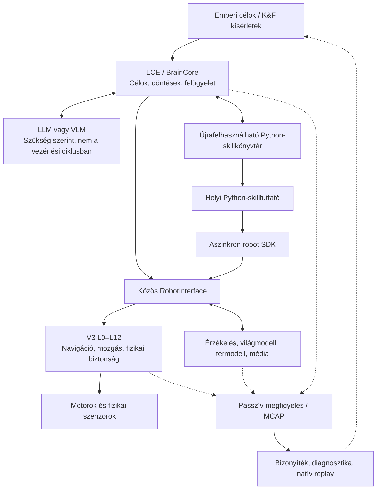

# R2B4

### Fizikai kutatóplatform embodied AI-hoz, alkalmazkodó robotviselkedéshez és újrafelhasználható, géppel létrehozott skillekhez

**Raspberry Pi 5 · Autonóm mobilrobotika · Local Cognitive Executive · Python-skillgenerálás · Mérésalapú fejlesztés**

Az R2B4 kísérleti beltéri mobilrobot és nyitott kutatás-fejlesztési projekt. Azt vizsgálja, hogyan válhat a **nyelvi intelligencia tartósan használható, végrehajtható robotviselkedéssé**.

Az alapgondolat: a robotnak nem kell minden vezérlési lépésnél nagy nyelvi modellt (LLM-et) kérdeznie. A felső intelligencia értelmezhet célokat, új viselkedést tervezhet vagy programozhat, tesztelheti és javíthatja azt, majd **újrafelhasználható, helyben futó Python-skillként** megtarthatja. A fizikai mozgásért eközben továbbra is egy determinisztikus robotvezérlő rendszer felel.

**Projektállapot:** gyorsan fejlődő kutatási prototípus, nem kész, általánosan megbízható háztartási segítőrobot. A megírt forráskód és a sikeres automatikus tesztek önmagukban nem bizonyítják a valós környezetben működő, tartós autonómiát.

## Kutatási kérdések

Az R2B4 négy összefüggő problémát vizsgál:

1. **A nyelvi utasítástól a fizikai cselekvésig.** Hogyan állíthat elő a kognitív rendszer egy szabadon megfogalmazott emberi célból a robot *valós* képességeire és érzékelésére épülő programot?
2. **Az egyszeri megoldástól az újrafelhasználható skillig.** Lehetséges-e a létrehozott viselkedést elmenteni, mérni, tesztelni, javítani, majd később folyamatos LLM-kapcsolat nélkül futtatni?
3. **A vezérléstől a megtestesült intelligenciáig.** Hogyan maradhat kísérletező és rugalmas a felső intelligencia úgy, hogy a kiszámíthatatlan AI-terhelés ne zavarja a robot időkritikus vezérlését?
4. **Az érzékeléstől a bizonyítható fejlődésig.** Hogyan segíthetik a felvételek, az újrajátszás, a diagnosztika és a tartós világmodell a megismételhető, ellenőrizhető fejlesztést?

Ezekhez egy célzott, a tényleges robot hardverére épülő architektúra készül, nem egy általános agent-keretrendszer.

## A rendszer jelenlegi állapota

| Kutatási terület | Már megvalósult | Fontos korlát |
| --- | --- | --- |
| **Mobilrobot-vezérlés** | Natív V3 L0–L12 architektúra, körülbelül 50 Hz-es vezérlés, szenzorfeldolgozás, navigáció, biztonsági felügyelet és egységes motorvezérlési út | A tényleges mozgásminőség és a valós környezetben mutatott megbízhatóság továbbra is kísérleti |
| **Helyi kognitív irányítás** | `BrainCore` / Local Cognitive Executive (LCE), célkezelés, prioritás, viselkedések, megszakítás és eredménykövetés | Egy program sikeres lefutása nem bizonyítja az ember által kért fizikai cél teljesülését |
| **Közös robotinterfész** | `RobotInterface`, képességlekérdezés és aszinkron Python SDK | A képességlefedettség bővül; az elérhetőséget az élő szenzor- és szolgáltatásállapot határozza meg |
| **Végrehajtható skillrendszer** | `.py` fájlokra épülő könyvtár, külön Python-folyamat, forrásváltozat-azonosítás, futásállapot és leállítás | Az integráció tesztelt, a felügyelet nélküli használat valós bizonyítása további feladat |
| **LLM-együttműködés** | A modell javasolhat meglévő skillt, létrehozhat vagy módosíthat Python-programot; a mentett teszt hibája korlátozott javítási kört indíthat | Teljes, nyitott végű önfejlődési ciklus még nincs bizonyítva fizikai robottal |
| **Érzékelés és memória** | Kamera- és személyészlelés, időérzékeny publikus világmodell, személyazonosság és térbeli referenciák | Egér- és ajtóállapot-felismerés, biztos szobaszemantika és globális helymeghatározás nem következik ebből |
| **Kutatási mérőrendszer** | Passzív observer, MCAP-feketedoboz, Evidence Compiler, diagnosztika és natív V3 replay | A pontos vezérlési újrajátszáshoz teljes, sértetlen 50 Hz-es adatfelvétel szükséges |
| **Térképezés és szimuláció** | 50 Hz-es MCAP-ból dolgozó offline térképkészítő és célzott szintetikus/replay tesztek | Az egységes tanulási szimulátor és az önálló IDLE térképezési ciklus fejlesztési cél |

Az első helyi megfigyelési skill, a [`monitor_region.py`](robot_skills/monitor_region.py) **képen kijelölt területen észlel személyeket**, eseményekre reagál és videofelvételt kér. Nem általános egérdetektor, nem teljes szobaértelmező rendszer, és nyolcórás megbízható élő működése még nem bizonyított.

## Architektúra: szabad felső intelligencia, önálló fizikai vezérlés



A **V3** a fizikai végrehajtás gazdája. Az **LCE** az emberi célok és a felső döntések gazdája. A **Python-skillek** tetszőleges feltételeket, ciklusokat, állapotot és érzékelésre reagáló programlogikát tartalmazhatnak. Az **LLM** tervező- és fejlesztőpartner lehet, de nem része az 50 Hz-es vezérlési ciklusnak. Az **SDK nem ad közvetlen motor- vagy GPIO-hozzáférést**; a támogatott mozgások a meglévő V3 úton, a STOP elsőbbségével futnak.

Ez az elkülönítés a kutatási modell alapja. A külön Python-folyamat segít a hibák elszigetelésében, de **nem operációsrendszer-szintű biztonsági sandbox**.

## Kétféle intelligens működés, ugyanazon roboton

**Már ismert feladat esetén:** az LCE kiválaszthat egy telepített viselkedést vagy korábban elmentett Python-skillt, helyben futtathatja és értékelheti az eredményt — a modell folyamatos hívása nélkül.

**Új viselkedés esetén:** a kognitív rendszer új vagy javított Python-programot kérhet, elmentheti a közös skillkönyvtárba, szükség esetén futtathatja az eltárolt teszteket, majd az LCE felügyelete alatt elindíthatja. Ugyanez a forráskód hagyományos fejlesztőeszközökkel is szerkeszthető. A már futó skill a betöltött forrásváltozatot használja; a módosítás következő indításkor lép életbe.

A vizsgált fejlesztési ciklus:

**Cél → valódi képességek feltérképezése → terv vagy Python-skill → teszt → helyi futás → mért eredmény → szükség szerinti javítás → újrafelhasználás.**

Ennek több eleme elkészült és integrációs tesztekkel ellenőrzött. A fizikai környezetben, önállóan és folyamatosan fejlődő intelligencia továbbra is kutatási cél.

## Fizikai platform

- **Számítógép:** Raspberry Pi 5 (4 GB), Linux és Python.
- **Hajtás:** differenciálhajtású alváz, kerékjeladók, két DRV8871 motorvezérlő.
- **Érzékelők:** RPLIDAR C1, BNO055 IMU, Raspberry Pi Camera Module 3 / IMX708.
- **Vezérlés:** natív V3 rétegrendszer, szükség szerint külön szenzor- és számítási folyamatok, egységes mozgás- és STOP-út.
- **Környezet:** beltéri, gyakran szűk terek; az érzékelési hibák, takarások, padlóviszonyok és hajtási sajátosságok a kutatás valós korlátai.

Az aktuális beállítások a [`conf/`](conf/) mappában találhatók; ez a README nem rögzít változó kalibrációs értékeket.

## Nem elég, hogy a program azt mondja: sikerült

Az R2B4 külön kezeli **a kért műveletet, az elfogadott parancsot, a program befejezését és a tényleges fizikai eredmény igazolását**. Ezek nem azonos dolgok.

A passzív megfigyelési és rögzítési rendszer összeköti a Brain, a RobotInterface és a robotfuttató eseményeit. Az MCAP-felvételekből lekérdezhető bizonyíték készíthető, és megfelelő nyers adatok birtokában a V3 natív futtatási útja offline újrajátszható. A teljes 50 Hz-es felvételből külön eszköz tud globális térképet rekonstruálni.

Ez lehetővé teszi az időzítés, az érzékelési minőség, a helymeghatározás, a döntések és a hibák reprodukálható elemzését. Egy sikeres automatikus teszt, szimuláció vagy replay-eredmény kizárólag azt bizonyítja, amit ténylegesen megvizsgált.

## A következő kutatási határ

A fő kutatási irányok: **új skillek létrehozása és értékelése élő roboton**, megismételhető tanulási és javítási kísérletek, hosszú idejű helyi megfigyelés, gazdagabb szemantikus tér- és világmodell, valamint Raspberry Pi 5-re szabott gyors szimulációs kísérleti környezet. Külön kihívás a valós beltéri navigáció és a személyekkel való együttműködés következetesen megbízhatóvá tétele.

A projekt kutatási inspirációi: **[SayCan](https://arxiv.org/abs/2204.01691)**, **[SayPlan](https://arxiv.org/abs/2307.06135)**, **[Code as Policies](https://arxiv.org/abs/2209.07753)** és **[Voyager](https://arxiv.org/abs/2305.16291)**. Az R2B4 ezek elveiből merítő, saját hardverre szabott kutatás — **nem** a publikált rendszerek változatlan másolata, és nem állít velük azonos teszteredményt.

## Kiindulópontok a forráskódban

| Dokumentum / forrás | Mit érdemes benne keresni? |
| --- | --- |
| [`robot_skills/README.md`](robot_skills/README.md) | A helyi Python-skillrendszer és tényleges korlátai |
| [`docs/LCE_LLM_COOPERATION_PLAN.md`](docs/LCE_LLM_COOPERATION_PLAN.md) | A nyitott skillrendszer és az LCE–LLM együttműködés kutatási terve; néhány készültségi megjegyzése már elavult |
| [`docs/PUBLIC_ROBOT_SYSTEM.md`](docs/PUBLIC_ROBOT_SYSTEM.md) | A közös világmodell, Brain, behavior és robotinterfész |
| [`STRUKTURALIS_RETEGEK_V3.md`](STRUKTURALIS_RETEGEK_V3.md) | Normatív robotarchitektúra és fizikai felelősségek |
| [`ASZINKRON_RUNTIME_CONTRACT_V3.md`](ASZINKRON_RUNTIME_CONTRACT_V3.md) | A szenzorok, számítások és időkritikus vezérlés határai |
| [`docs/MCAP_EVIDENCE.md`](docs/MCAP_EVIDENCE.md) | MCAP Evidence Compiler és felvételelemzés |
| [`tools/mcap50-to-map.py`](tools/mcap50-to-map.py) | Offline globális térképkészítés felvett adatokból |
| [`docs/PYTEST_POLICY.md`](docs/PYTEST_POLICY.md) | Tesztelési szintek és bizonyítási követelmények |

Az előkészített R2B4 környezetben az első tájékozódó parancsok:

```bash
./r help
./r caps --json
./r test
```

A `./r test` rövid, alapvető működési teszt, **nem** a robot fizikai elfogadási próbája. Az élő mozgás megfelelő környezetet és kifejezett operátori engedélyt igényel.

---

**Az R2B4 annak kutatására épül, hogyan válhat a nyelvi tervezésből tartós, valódi érzékelésre és fizikai hatásokra támaszkodó robot-skill — ellenőrizhető mérésekkel, nem puszta sikerállításokkal.**
