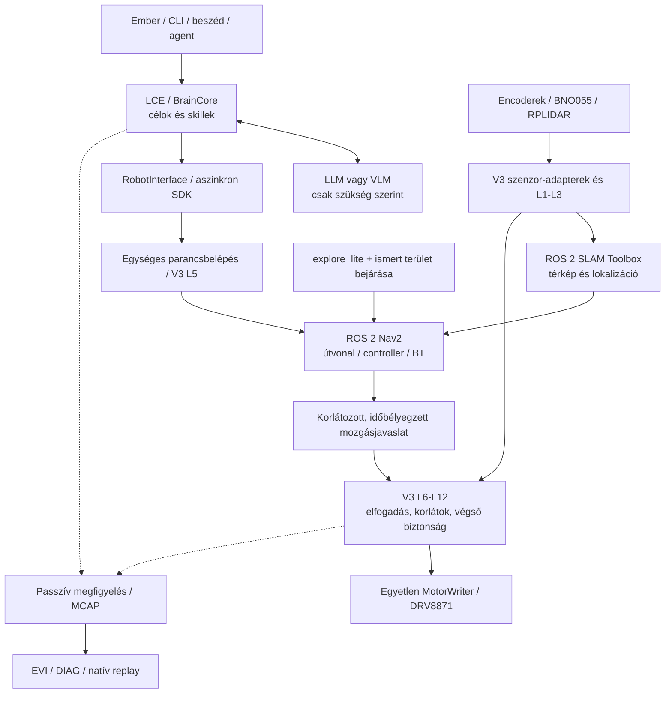

# R2B4 — Embodied AI egy valódi mobilroboton

**GitHubon nyilvánosan elérhető, Raspberry Pi 5 alapú kutatási projekt autonóm mobilrobotikához, helyi mesterséges intelligenciához és újrafelhasználható Python-skillekhez.**

[English README / Angol leírás](README.md)

Az R2B4 valódi érzékelőket és motorokat kapcsol össze réteges robotvezérléssel, ROS 2 navigációval, helyi kognitív döntéshozóval (LCE) és opcionális nyelvi modellekkel. A kutatás egyik fő célja, hogy az emberi utasításokból **tartósan futtatható és ellenőrizhető robotviselkedés** legyen, miközben a mozgás időkritikus vezérlése nem függ az LLM-től.

> **Állapot — 2026. november 11.:** Aktívan fejlesztett **kutatási prototípus**, nem kész, általánosan megbízható autonóm robot. A szoftveres integrációk, a diagnosztikai útvonalak és a célzott tesztek léteznek, de egy sikeres teszt vagy replay **nem** bizonyítja az órákig felügyelet nélküli navigációt, minden akadály elkerülését vagy tetszőleges fizikai feladat sikerét. Ez a leírás a `main` ág [`d19d4aa`](https://github.com/Francigofree/r2b4/commit/d19d4aa036ab8b9858570d3f264fe6c856cb4da1) verziójához készült. A jelenlegi működést mindig a forráskódból és az aktív konfigurációból kell ellenőrizni.

## Mi működik jelenleg a szoftverben?

| Terület | Megvalósított képesség | Fontos korlát |
| --- | --- | --- |
| **Fizikai vezérlés (V3)** | Determinisztikus L0–L12 lánc, névlegesen 50 Hz-es vezérlés, encoder/IMU/LiDAR-adatok, differenciálhajtás és egyetlen végső motor-/biztonsági döntési pont | A tényleges mozgásminőséget, időzítést és megbízhatóságot élő mérésekkel kell igazolni |
| **Térképezés és helymeghatározás** | Külön ROS 2 Jazzy környezetben futó **SLAM Toolbox**, élő térképpel és helyzetkorrekcióval; a V3 megőrzi a saját lokális becslését és biztonsági szenzorútját | Egy korábban mentett térkép nem válik automatikusan érvényes helymeghatározási alappá a robot áthelyezése vagy újraindítása után |
| **Navigáció** | Teljes **Nav2**: Planner Server, Controller Server, BT Navigator, globális/lokális akadálytérkép és az R2B4 kerékminimumához igazított Regulated Pure Pursuit vezérlő | A Nav2 mozgásjavaslatot ad a V3-nak, **nem** közvetlen motorparancsot; a helyreállító manőverek és a szűk terekben való mozgás még kísérletiek |
| **Room Cruise** | ROS 2 `explore_lite` frontier-keresés, majd a már ismert szabad terület további **bejárása** a Nav2 costmap alapján | Egy kiválasztott cél önmagában nem bizonyítja, hogy a robot a teljes szobát feltérképezte vagy bejárta |
| **Helyi intelligencia** | `BrainCore`/LCE: célok, feladatlépések, viselkedések, megszakítás és eredménykövetés; közös `RobotInterface` | Az elfogadott parancs, a program befejezése és az emberi cél valós teljesülése külön fogalom |
| **Python-skillek** | Elmentett `.py` programok, aszinkron robot-SDK, külön Python-folyamat, forrásverzió-azonosítás, leállítás és motormentes skillpróbák | A külön folyamat nem biztonsági sandbox; a generált skillek ellenőrzést igényelnek |
| **Érzékelés és kommunikáció** | Kamerakezelés, személyészlelés/-követés, kép-/videófelvétel, személyhez kapcsolódó viselkedések, beszéd/STT/TTS és opcionális LLM | A személydetektálás nem garantált személyazonosítás és nem teljes környezetértelmezés |
| **Mérés és fejlesztés** | MCAP-feketedoboz, Evidence Compiler (EVI), diagnosztika (DIAG), natív V3 replay, szimuláció és offline hangolás | Az 1/5/10 Hz-es mintavett felvétel nem helyettesíti a teljes 50 Hz-es replay-bemenetet |

## Felépítés: szabad felső intelligencia, egyetlen fizikai végrehajtó



Az ábra egyszerűsített: a valós SLAM/Nav2 adatút külön folyamatokban, eredeti mérési időbélyegekkel működik. **A ROS 2 nem ír közvetlenül motort.** A navigációs eredményt a V3-nak kell elfogadnia; az egyetlen végső normál motorírásról az L12 dönt. Elavult adat, hibás azonosító vagy hiányzó biztonsági mérés nem jogosíthat további mozgásra.

### Fizikai vezérlés és biztonság

- A [`v3/engine.py`](v3/engine.py) hajtja végre a determinisztikus rétegláncot; a [`v3_runtime.py`](v3_runtime.py) kezeli a folyamatosan futó fizikai vezérlést.
- A rétegek birtokolják a saját döntéseiket. A szenzorolvasás, a SLAM, a ROS navigáció, a kamera és a nagyobb vagy változó idejű számítások lehetőség szerint korlátozott, külön folyamatokban működnek.
- A jelenlegi [`conf/fizika.json`](conf/fizika.json) szerint a robot teste **36 × 36 cm**, a testközép **8 cm-rel** a keréktengely előtt van, a nyomtáv **0,3557 m**, a LiDAR X-eltolása **−0,005 m**.
- A jelenlegi L12 közelségi STOP-küszöb **0,10 m a robot fizikai testkörvonalától mérve**, nem a LiDAR középpontjától. Ez **beállított küszöb**, nem minden helyzetre érvényes ütközésmentességi garancia.
- A [`conf/speed_map.json`](conf/speed_map.json) tartalmazza a hajtás kalibrációját; a tartós keréksebesség alsó határa **0,15 m/s**. A parancsbelépés felső lineáris korlátja **0,50 m/s**, az egyes feladatok ennél szigorúbbak lehetnek.
- A STOP, a hibakezelés, a parancskiadó folyamat élettartama és a motor GPIO-k végállapota a V3 biztonsági útjához kötött. A ROS, az LLM és a skillek nem kaphatnak külön motorvezérlési útvonalat.

### A jelenlegi ROS 2–SLAM–Nav2 rendszer

Az aktív [`conf/vezerles.json`](conf/vezerles.json) a `lidar_runtime.global_backend = "slam_toolbox"` és a `runtime.nav2_navigation` utat használja; a korábbi `runtime.nav2_planner` beállítás **ki van kapcsolva** (`null`).

1. **SLAM Toolbox:** az időben összehangolt LiDAR- és odometria-adatokból térképet készít; a V3 L3 minősíti és fogadja el a helyzetkorrekciót.
2. **Nav2:** globális és lokális akadálytérképen tervez. Egy saját, keréksebesség-korlátokat figyelembe vevő controller mozgásjavaslatot állít elő, nem közvetlen GPIO/PWM-jelet.
3. **Room Cruise:** először a ROS 2 `explore_lite` keresi a feltérképezett és ismeretlen területek határát (*frontier*). Amikor ez véget ér, a `v3/adapters/room_cruise.py` az ismert szabad területekhez javasolhat további célokat. Az útvonal és az akadályok ellenőrzése továbbra is Nav2-feladat.
4. **V3 L6–L12:** megvizsgálja a javaslat idejét és a mission azonosságát, megvalósítja a fizikailag megengedett mozgást, és külön LiDAR-alapú végső biztonsági ellenőrzést végez.

A régi natív V3 lokális térkép és rollout algoritmus továbbra is megtalálható a repóban egyéb működési módokhoz és replayhez. **Nem automatikus tartalékmegoldás**, ha a teljes Nav2 működés megszakad. Nincs közvetlen ROS `cmd_vel → motor` kapcsolat, és a Nav2 behavior tree nem kerülheti meg a V3-at külön recovery-mozgással.

A ROS-komponensek telepített állapotban elkülönített Jazzy/RoboStack környezetben, a `runtime/deps/` alatt futnak. A függőségek rögzített leírásai és az egyedi adapterek fordítási szkriptjei a [`deploy/`](deploy/) könyvtárban vannak. **A GitHub-repó letöltése önmagában nem telepíti a ROS-környezeteket és nem készíti elő a hardvert.**

## Hardver

A jelenlegi konfiguráció ehhez a platformhoz készült:

- **Raspberry Pi 5, 4 GB**, Linux; natív Python vezérlés és elkülönített ROS 2 folyamatok.
- Differenciálhajtás, **két DRV8871** motorvezérlő, encoderes hajtóműves motorok.
- **RPLIDAR C1**, **BNO055** IMU, Raspberry Pi **IMX708 Camera Module 3 Wide NoIR**.
- Opcionális mikrofon/hangszóró és LiteRT személydetektor; a tényleges működés a csatlakoztatott eszközöktől, modellektől és szolgáltatói hozzáférésektől függ.

A GPIO-kiosztás és a kalibráció forrása: [`conf/hardver.json`](conf/hardver.json), [`conf/fizika.json`](conf/fizika.json), [`conf/speed_map.json`](conf/speed_map.json), [`conf/vezerles.json`](conf/vezerles.json). Másik robotra ezeket mérés nélkül nem szabad átvenni.

## Használat az előkészített R2B4 gépen

Az [`r`](r) launcher a közös operátori és fejlesztői belépési pont. A parancsok naprakész listája a tényleges CLI-definíciókból épül fel; ezt érdemes használni a régi parancslisták helyett.

**Állapot és szoftveres ellenőrzés, mozgáskérés nélkül:**

```bash
./r help
./r commands --json
./r s
./r caps --json
./r test
```

**A teljes stack előkészítése mozgáskérés nélkül, már telepített roboton:**

```bash
./r rt start c full c 5
./r slam status
./r nav2 status
```

Ezek az indítások önmagukban nem kérnek helyiségbejárást. Az alábbi példa viszont **fizikai robotmozgást indít**, ezért csak felügyelt, előkészített környezetben, a STOP-út és a szenzorok ellenőrzése után használható:

```bash
./r rc 60 c full         # 60 másodperces Room Cruise, full 5 Hz capture — A ROBOT MOZOG
./r x                    # egységes STOP
```

A Room Cruise automatikusan előkészíti a konfigurált SLAM-, runtime- és Nav2-stacket.
A kért idő a mission végrehajtásakor indul. A runtime felügyelője kilépéskor
leállítja az általa indított szolgáltatásokat; a külön elindított szolgáltatások
az eredeti indítójukhoz tartoznak.

**Leállítás és az élő SLAM-térkép külön mentése:**

A külön térképmentést még futó runtime mellett végezd. A fenti előkészítéssel
indított runtime a cirkálás után is fut; a mentés után állítsd le:

```bash
./r slam save --output room_map
./r sd
```

Az alapértelmezett folyamatos `full` felvétel **5 Hz-es** mintavételt használ. A nagyobb erőforrás-igényű `c 50` a teljes szenzor-/hibakeresési és replay-bizonyítékhoz kérhető. A `c alap` rövid, eseményorientált gyűrűpuffer, a `c nincs` kikapcsolja a felvételt. A capture-módot az adott runtime-session előtt kell megválasztani.

## Python-skillek és helyi intelligencia

A skill egy közönséges Python-fájl `async def run(robot, **parameters)` belépési ponttal, a [`robot_skills/`](robot_skills/) könyvtárban. A külön Python-folyamat a közös aszinkron SDK-t használja, és nem importál közvetlen motorvezérlőt. A skillek listázhatók a kódjuk futtatása nélkül.

```bash
./r skill                                       # mentett skillek
./r skill monitor_region --parameters '{"duration_hours":0.01}' --json
./r execute skill.status --parameters '{"run_id":"ID"}' --json
./r execute skill.stop --parameters '{"run_id":"ID"}' --json
```

Példák: `room_cruise`, `follow_person`, `monitor_region` és `terkepesz_r2b4`. A **térképész** skill nem azonos az élő SLAM-mel: a bejárási szakasz már futó 50 Hz-es teljes capture-t igényel, az offline feldolgozási szakasz pedig csak a felvétel lezárása után épít történeti atlaszt. A történeti atlasz nem válik automatikusan a jelenlegi robotpozícióhoz illesztett navigációs térképpé.

Az LCE ismert feladatokat folyamatos LLM-hívások nélkül is futtathat. Az opcionális nyelvi modell segíthet az utasítás értelmezésében, képességválasztásban, valamint Python-skillek létrehozásában és próbájában. Az `r learn` korlátozott, **motor nélküli** tanulási kísérleteket biztosít; ezek nem bizonyítják a fizikai feladat sikerét. A beszéd- és beszélgetéskezelés a V3 50 Hz-es vezérlésén kívül működik.

## Mérésalapú fejlesztés: MCAP, EVI, DIAG, replay

A projekt tudatosan külön kezeli a **kérést → elfogadott parancsot → program által jelentett befejezést → tényleges fizikai eredményt igazoló bizonyítékot**.

- **MCAP:** a V3 és egyes felső/ROS-megfigyelések passzív feketedoboz-felvétele, külön adatvesztés- és teljességjelzéssel.
- **EVI:** a lezárt MCAP külön, offline, forrásmegőrző feldolgozója; lekérdezhető bizonyítékot készít, nem vezérli a robotot.
- **DIAG:** ellenőrzött EVI-adatokból mérési számokat, navigációs gyökérok-hipotéziseket, adatminőséget és forráshivatkozásokat állít elő.
- **Natív replay:** teljes bemenet, állapot és konfiguráció esetén újrafuttatja a V3 eredeti döntési láncát. A `MATCH` szoftveres egyezés, **nem** fizikai sikerigazolás.

```bash
./r evi latest --workers 1
./r diag full latest --json
./r test release
```

A `./r test` a rövid, kötelező robot-contract ellenőrzés; a `./r test release` hozzáadja a felhasználói működést lefedő scenariókat. A feature/deep csomagok és a hosszú stressztesztek ettől különállók; lásd [`docs/PYTEST_POLICY.md`](docs/PYTEST_POLICY.md). Aktív robot mellett részletes állapotolvasásra a live parancsokat használd, ne a vezérlő CPU-t terhelő offline elemzést.

## A repó felépítése

| Könyvtár / fájl | Feladat |
| --- | --- |
| [`v3/`](v3/) és [`v3_runtime.py`](v3_runtime.py) | Natív L0–L12 vezérlés, szenzoradapterek, motorvezérlés, egységes végrehajtás és replay |
| [`v3/nav2_navigation_bridge.py`](v3/nav2_navigation_bridge.py), [`v3/adapters/room_cruise.py`](v3/adapters/room_cruise.py) | ROS oldali Nav2 kapcsolat és Room Cruise célválasztás |
| [`tools/slam_toolbox.py`](tools/slam_toolbox.py), [`tools/nav2_planner.py`](tools/nav2_planner.py) | ROS-folyamatok indítása/leállítása és térképkezelés |
| [`deploy/`](deploy/) és [`conf/`](conf/) | Elkülönített ROS-függőségek, egyedi controller, fizikai és navigációs beállítások |
| [`r2b4_orchestration/`](r2b4_orchestration/) | LCE, publikus világmodell, térbeli memória, skillek, tanulás, aszinkron SDK |
| [`r2b4_voice/`](r2b4_voice/) | Beszéd, beszélgetés, opcionális nyelvimodell-szolgáltatók, tartalék szolgáltatóválasztás |
| [`robot_skills/`](robot_skills/) | Újrafelhasználható Python-viselkedések és példák |
| [`tools/mcap_evidence/`](tools/mcap_evidence/), [`tools/diag/`](tools/diag/) | Offline bizonyítékfeldolgozás és diagnosztika |
| [`tests/`](tests/) | Alapvető robot-contract tesztek, scenariók, fejlesztői tesztcsomagok, hosszú próbák |
| [`docs/analysis/`](docs/analysis/) | **Dátumozott történeti futásjelentések**, nem feltétlenül aktuális használati leírások |

### Melyik dokumentumot érdemes olvasni?

- [`STRUKTURALIS_RETEGEK_V3.md`](STRUKTURALIS_RETEGEK_V3.md) — a rétegek, a biztonság, a fizikai felelősség és a mérési bizonyítékok kötelező szabályai.
- [`ASZINKRON_RUNTIME_CONTRACT_V3.md`](ASZINKRON_RUNTIME_CONTRACT_V3.md) — a külön szenzor-/számítási folyamatok elhelyezésének szabályai.
- [`AGENTS.md`](AGENTS.md) — source-first fejlesztési és biztonsági munkamód.
- [`docs/SLAM_TOOLBOX_INTEGRACIO.md`](docs/SLAM_TOOLBOX_INTEGRACIO.md), [`docs/NAV2_PLANNER.md`](docs/NAV2_PLANNER.md) — ROS-integráció. Utóbbi még tartalmaz egy kifejezetten **történetinek jelölt planner-only** részt.
- [`docs/R_LAUNCHER.md`](docs/R_LAUNCHER.md), [`robot_skills/README.md`](robot_skills/README.md) — parancsok és Python-skillhasználat.
- [`docs/MCAP_EVIDENCE.md`](docs/MCAP_EVIDENCE.md), [`docs/DIAG.md`](docs/DIAG.md), [`docs/PYTEST_POLICY.md`](docs/PYTEST_POLICY.md) — felvételek, diagnosztika és tesztek.

**Forráselsőbbségi szabály:** a V3 contractok a kötelező architekturális határokat írják elő, az aktuális production kód és a **feloldott aktív konfiguráció** mutatja meg, hogy most mi van bekötve. Régi tervek, korábbi tesztjelentések és példakonfigurációk nem bizonyítják a jelenlegi élő működést. Eltérés esetén a konkrét ellentmondást fel kell tárni.

## Következő kutatási célok

Az R2B4 fő fejlesztési irányai: reprodukálható beltéri AMR-viselkedés, pontosabb és megbízhatóbb lokalizáció, akadálykezelés és recovery, tartós és újrafelhasználható LLM-segített Python-skillek, érzékeléshez kötött szemantikus világmodell, személyinterakció és hosszabb felügyelt működés. A dokkolás, centiméteres pontosságú tárgymozgatás, megbízható többhelyiséges autonómia és korlátlan önfejlődés **kutatási cél**, nem a jelen verzióval bizonyított eredmény.

A projekt többek között a [SayCan](https://arxiv.org/abs/2204.01691), [SayPlan](https://arxiv.org/abs/2307.06135), [Code as Policies](https://arxiv.org/abs/2209.07753) és [Voyager](https://arxiv.org/abs/2305.16291) kutatásokból merít, azok eredményeinek reprodukálását nem állítja.

## Licenc

A vizsgált repóverzióban nem található `LICENSE` fájl. A forráskód nyilvános elérhetősége **önmagában nem ad** továbbterjesztési vagy újrafelhasználási jogot; ennek feltételeit a tulajdonossal kell tisztázni.
