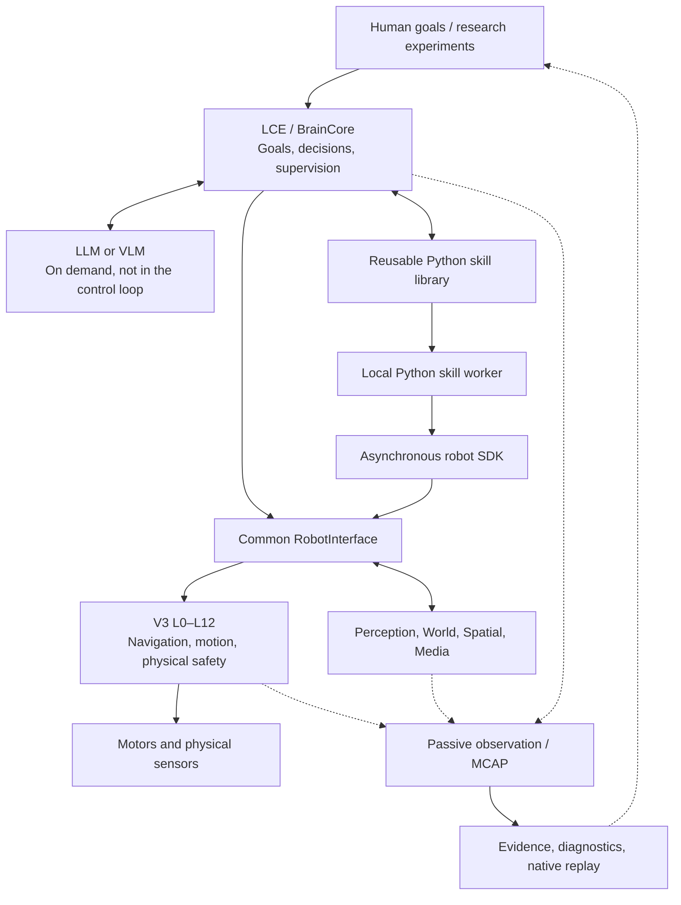

# R2B4

### A physical research platform for embodied AI, adaptive robot behavior, and reusable machine-generated skills

**Raspberry Pi 5 · Autonomous mobile robotics · Local Cognitive Executive · Python skill synthesis · Evidence-driven development**

R2B4 is an experimental indoor mobile robot and an open-ended research project exploring how **language-guided intelligence can become persistent, executable robot behavior**.

Its central premise is simple: a robot should not need to consult a large language model at every control step. Higher-level intelligence can interpret goals, compose or write new behaviors, test and refine them, and leave behind **reusable local Python skills**. The robot then executes those skills through a common interface while a deterministic control system remains responsible for physical motion.

**Project status:** an actively developed research prototype, not a production-ready autonomous assistant. Working software architecture and automated integration tests are not presented as proof of robust real-world autonomy.

## Research questions

R2B4 investigates four connected problems:

1. **From language to action.** Can a cognitive agent translate an unconstrained human goal into an executable program grounded in the robot's *actual* capabilities and observations?
2. **From a single solution to a reusable skill.** Can generated behaviors be saved, tested, improved, and executed later without continuous LLM participation?
3. **From control to embodied intelligence.** How can higher-level experimentation remain flexible without coupling unpredictable AI workloads to time-critical robot control?
4. **From observations to trustworthy improvement.** Can recordings, replay, diagnostics, and a persistent world model support reproducible analysis rather than unverified success claims?

These questions guide an intentionally small, hardware-grounded architecture rather than a general-purpose agent framework.

## The system today

| Research area | Current implementation | Important boundary |
| --- | --- | --- |
| **Mobile robot control** | Native V3 L0–L12 execution architecture, approximately 50 Hz control, sensor integration, navigation, safety and canonical motor ownership | Real-world movement quality and robustness remain experimental |
| **Local cognitive control** | `BrainCore` / Local Cognitive Executive (LCE), goals, priorities, behavior lifecycle, cancellation and result tracking | A completed software operation does not prove that the human's physical goal was achieved |
| **Robot capability interface** | Shared `RobotInterface`, discoverable capabilities and an asynchronous Python SDK | Capability coverage is growing; availability depends on live owners and sensors |
| **Executable skill system** | File-based `.py` library, separate CPython worker, versioned source identity, runtime status and cancellation | Integration is tested; general unattended operation needs further field validation |
| **LLM collaboration** | Provider-facing proposals can select, create, update and optionally test Python skills; failed saved tests can prompt a bounded repair attempt | An autonomous, open-ended learning loop has not yet been demonstrated end-to-end in the physical world |
| **Perception and memory** | Camera/person perception, public temporal world model, person identity and spatial references | Mouse/door recognition, reliable room semantics and global localization are not implied |
| **Research instrumentation** | Passive observer, MCAP flight recording, explicit Evidence Compiler, diagnostic tools and native V3 replay | Exact decision replay needs complete, valid 50 Hz capture evidence |
| **Mapping and simulation** | Offline 50 Hz MCAP-to-map tool and targeted synthetic/replay tests | A general integrated learning simulator and autonomous IDLE mapping cycle are future work |

The first local observation skill, [`monitor_region.py`](robot_skills/monitor_region.py), watches an **image-space region for people**, responds to local detector events and requests video clips. It is not a general mouse detector, room-aware observer or field-proven eight-hour surveillance system.

## Architecture: intelligence above, physical authority below



**V3** is the real-time physical execution owner. **LCE** owns semantic goals and upper-level decisions. **Python skills** can express loops, conditions, state, perception-driven reactions and composition using ordinary Python. The **LLM** can act as a planner and skill-development partner, but is not part of the 50 Hz control cycle. **The SDK does not provide direct motor/GPIO authority**; accepted physical actions follow the existing canonical V3 path, including STOP handling.

This separation is central to the experiment. Isolating a skill in a separate process is failure isolation, **not** an operating-system security sandbox.

## One idea, two execution modes

**When a capability is already known:** the LCE can choose an installed behavior or saved Python skill, run it locally, inspect its result and proceed without repeated model calls.

**When a new behavior is required:** the cognitive system can request a new or revised Python program, save it in the shared skill library, optionally run saved tests, and initiate an LCE-owned execution. The source can also be edited using ordinary developer tools. A running invocation retains the source version it loaded; changes take effect on a later invocation.

The supported research loop is:

**Goal → capability discovery → plan or Python skill → test → local execution → observed outcome → possible revision → reuse.**

Parts of this loop are implemented and integration-tested. Continuous autonomous skill evolution in unstructured physical environments remains a research objective.

## Physical platform

- **Compute:** Raspberry Pi 5 (4 GB); Linux and Python.
- **Drive:** differential-drive chassis, wheel encoders and two DRV8871 motor drivers.
- **Sensing:** RPLIDAR C1, BNO055 IMU and Raspberry Pi Camera Module 3 / IMX708.
- **Control:** native V3 layered execution, independent sensor/compute workers where appropriate, canonical motion and STOP paths.
- **Operating environment:** small indoor spaces; real-world sensing, floor conditions, occlusion and motor behavior are active experimental constraints.

Active parameters are defined in [`conf/`](conf/), not in this overview.

## Evidence is part of the experiment

R2B4 distinguishes **a requested action, an accepted command, a completed operation and a demonstrated physical outcome**. They are not interchangeable.

Its passive observation and recording pipeline links host/Brain/Interface events with robot runtime information. MCAP captures can be compiled into queryable evidence and, where the required raw inputs are present, replayed through the native V3 execution path. Offline global map reconstruction from suitable 50 Hz recordings is provided as a separate research tool.

This instrumentation enables investigations of timing, sensor quality, localization, decision provenance and failures. A successful unit test, simulator trace or replay verdict only establishes what that test actually measured.

## Current research frontier

The next major investigations are **capability-grounded skill creation in live settings**, reproducible skill evaluation and improvement, long-running local perception tasks, richer semantic and spatial grounding, and an efficient simulation/experimentation loop suited to Raspberry Pi 5. A further challenge is making physical navigation and person interaction consistently reliable across realistic indoor conditions.

The project draws inspiration from **[SayCan](https://arxiv.org/abs/2204.01691)**, **[SayPlan](https://arxiv.org/abs/2307.06135)**, **[Code as Policies](https://arxiv.org/abs/2209.07753)** and **[Voyager](https://arxiv.org/abs/2305.16291)**. R2B4 is a hardware-specific experiment inspired by these ideas, **not** a reproduction of their published results or a claim of comparable benchmark performance.

## Explore the repository

| Start here | What it documents |
| --- | --- |
| [`robot_skills/README.md`](robot_skills/README.md) | Existing local Python skill workflow and its concrete limitations |
| [`docs/R_LAUNCHER.md`](docs/R_LAUNCHER.md) | Simple skill/evidence/diagnostics commands and parser-driven launcher discovery |
| [`docs/LCE_LLM_COOPERATION_PLAN.md`](docs/LCE_LLM_COOPERATION_PLAN.md) | Research direction for open skills and LCE–LLM cooperation; some status text predates the implementation |
| [`docs/PUBLIC_ROBOT_SYSTEM.md`](docs/PUBLIC_ROBOT_SYSTEM.md) | Public world, Brain, behavior and interface semantics |
| [`STRUKTURALIS_RETEGEK_V3.md`](STRUKTURALIS_RETEGEK_V3.md) | Normative physical architecture and ownership boundaries |
| [`ASZINKRON_RUNTIME_CONTRACT_V3.md`](ASZINKRON_RUNTIME_CONTRACT_V3.md) | Asynchronous device, compute and control boundary |
| [`docs/MCAP_EVIDENCE.md`](docs/MCAP_EVIDENCE.md) | Evidence Compiler and recording analysis |
| [`tools/mcap50-to-map.py`](tools/mcap50-to-map.py) | Offline global occupancy-map reconstruction from recorded data |
| [`docs/PYTEST_POLICY.md`](docs/PYTEST_POLICY.md) | Test scopes and evidence requirements |

For a first inspection in a configured R2B4 environment:

```bash
./r help
./r caps --json
./r test
```

`./r test` is a small contract gate, not a full physical acceptance test. Motion requires an appropriately prepared live robot and explicit operator authorization.

---

**R2B4 is a research platform for investigating the transition from language-guided planning to persistent, physically grounded robot skills — with reproducibility and honest evidence boundaries as part of the design.**
