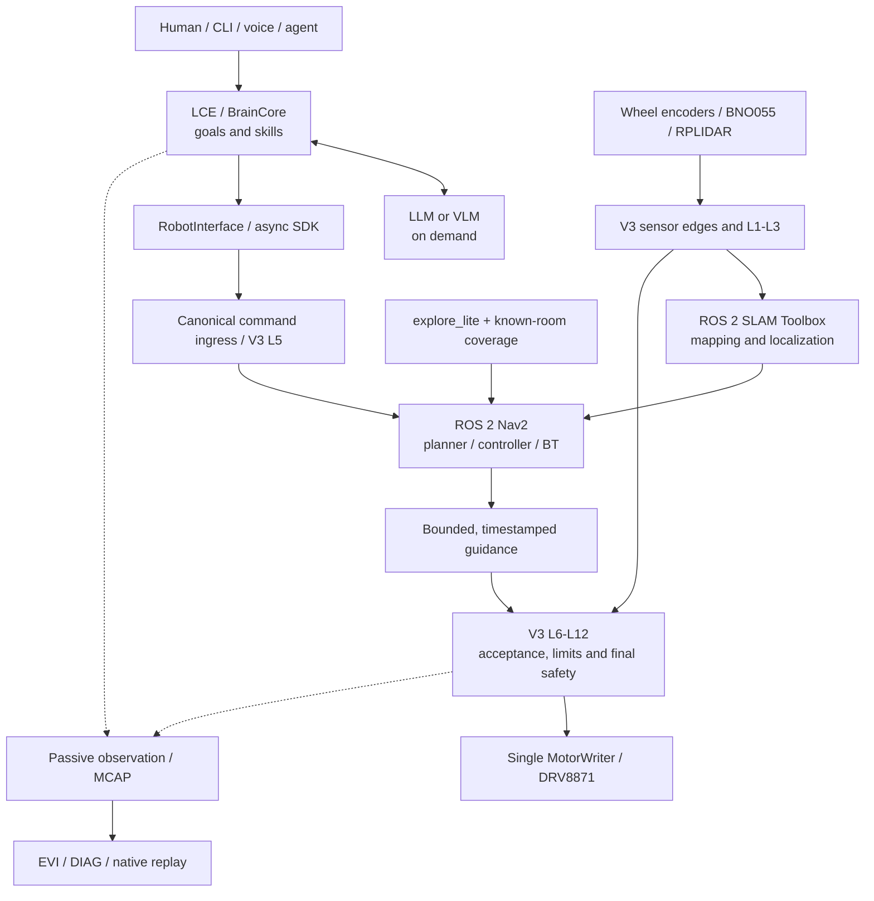

# R2B4 — Embodied AI on a real mobile robot

**A publicly accessible Raspberry Pi 5-based research project for autonomous mobile robotics, local cognitive control and reusable Python skills.**

[Magyar leírás / Hungarian README](README.hu.md)

R2B4 connects real sensors and motors to a layered robot controller, ROS 2 navigation, a local cognitive executive (LCE), and an optional language-model interface. The research goal is to turn human instructions into **persistent, observable robot behavior** without putting an LLM in the time-critical motion loop.

> **Status — 11 November 2026:** Actively developed **research prototype**, not a production-ready autonomous robot. The architecture, software integrations, diagnostic paths and targeted tests are real; successful tests or replay do **not** establish reliable unattended navigation, collision avoidance in every environment, or successful completion of arbitrary physical tasks. This overview was checked against `main` at commit [`d19d4aa`](https://github.com/Francigofree/r2b4/commit/d19d4aa036ab8b9858570d3f264fe6c856cb4da1). For current behavior, use the source and active configuration rather than historical reports.

## What exists today

| Area | Implemented capability | Important limitation |
| --- | --- | --- |
| **Physical control (V3)** | Deterministic L0–L12 pipeline, nominal 50 Hz ticks, encoder/IMU/LiDAR inputs, differential-drive control and a single final motor/safety authority | Motion quality, timing and reliability need evidence from each live configuration |
| **Mapping and localization** | ROS 2 Jazzy **SLAM Toolbox** in a separate runtime, producing a live occupancy map and localization corrections; V3 retains its own local estimation and safety inputs | A saved map is not automatically a valid localization reference after moving or restarting the robot |
| **Navigation** | Full **Nav2** integration: Planner Server, Controller Server, BT Navigator, global/local costmaps and an R2B4 wheel-aware Regulated Pure Pursuit controller | Nav2 sends bounded guidance to V3, **not** motor commands; recovery and close-quarters behavior are still experimental |
| **Room Cruise** | ROS 2 `explore_lite` frontier discovery, followed by a bounded, costmap-based **known-room coverage** phase when no frontiers remain | Neither a frontier goal nor a coverage goal proves that an entire room has been physically mapped or traversed |
| **Local intelligence** | `BrainCore`/LCE owns semantic goals, task progress, behavior lifecycle and cancellation; shared `RobotInterface` connects it to robot capabilities | Goal admission, software completion and independently verified real-world outcome are different facts |
| **Python skills** | Saved `.py` skills, an async robot SDK, isolated worker processes, source-version tracking, cancellation and motor-free skill trials | Isolation is not a security sandbox; generated skills require review and bounded evaluation |
| **Perception and interaction** | Camera owner, person detection/tracking, image/media capture, person-oriented behaviors, voice/STT/TTS and optional LLM collaboration | Camera detections are not guaranteed identity recognition or reliable room-level scene understanding |
| **Evidence and tools** | MCAP flight recording, explicit Evidence Compiler (EVI), diagnostic analyzers (DIAG), canonical V3 replay, simulation and offline tuning | Sampled captures cannot be treated as complete 50 Hz replay input |

## Architecture: external intelligence, one physical authority



This diagram is simplified: the live Nav2 bridge and sensor paths exchange measurement-timestamped data through separate processes. **ROS 2 never owns the final motors.** A navigation result must enter the canonical V3 execution path; only L12 can authorize the final normal motor write. Stale input, invalid identity or missing safety evidence cannot authorize continued movement.

### Physical execution and safety

- `v3/engine.py` executes the single-tick layered pipeline; `v3_runtime.py` manages the resident physical runtime.
- Layers own their state and decisions. Sensor acquisition, SLAM, ROS navigation, vision and other variable-latency work are moved to bounded process/adapter edges wherever appropriate.
- The current robot geometry is defined in [`conf/fizika.json`](conf/fizika.json): **0.36 × 0.36 m** body, center **0.08 m** ahead of the wheel axis, **0.3557 m** wheel track and LiDAR X offset **−0.005 m**.
- The configured L12 LiDAR STOP clearance is **0.10 m from the physical body outline**, not 0.10 m from the laser origin. This is a **configured threshold**, not a guarantee that every obstacle is detected or every collision prevented.
- [`conf/speed_map.json`](conf/speed_map.json) defines wheel calibration and **0.15 m/s minimum sustained wheel speed**. The active command-ingress linear speed cap is **0.50 m/s**; mission-specific limits may be lower.
- STOP, fault handling, producer lifetime and final GPIO state remain inside the canonical safety/runtime design. Tools, ROS nodes, AI and Python skills do not get a second motor path.

### Current ROS 2 mapping and navigation

The active configuration [`conf/vezerles.json`](conf/vezerles.json) selects `lidar_runtime.global_backend = "slam_toolbox"` and `runtime.nav2_navigation`; the earlier `runtime.nav2_planner` mode is **disabled** (`null`).

1. **SLAM Toolbox** consumes correlated LiDAR scans and local odometry. Its ROS process owns the occupancy map; V3 L3 qualifies the accepted localization result.
2. **Nav2** plans through global/local costmaps. Its custom wheel-aware controller accounts for the practical wheel-speed constraints. It produces guidance, not direct GPIO/PWM actuation.
3. **Room Cruise** first obtains frontiers via upstream ROS 2 `explore_lite`; when frontier discovery completes, `v3/adapters/room_cruise.py` can propose destinations in already known free space. Nav2 still checks path feasibility and obstacles.
4. **V3 L6–L12** validates guidance freshness and mission context, realizes physically constrained movement and performs independent final LiDAR safety checks.

The older native V3 local map/rollout implementation remains in the repository for modes and replay that require it; it is **not an automatic fallback** from a failed full-Nav2 session. There is no direct ROS `cmd_vel → motor` bypass, and the Nav2 behavior tree does not issue separate recovery movements outside V3.

ROS components use isolated Jazzy/RoboStack environments under `runtime/deps/` when installed. Reproducible dependency descriptions and custom adapter build scripts are in [`deploy/`](deploy/). A Git clone alone does **not** install these environments or configure physical hardware.

## Hardware reference

The current project configuration targets:

- Raspberry Pi 5, **4 GB**, Linux, native Python control and isolated ROS 2 processes.
- Differential-drive chassis; two **DRV8871** drivers; encoder-equipped gearmotors.
- **RPLIDAR C1**; **BNO055** IMU; Raspberry Pi **IMX708 Camera Module 3 Wide NoIR**.
- Optional microphone/speaker path and LiteRT person detector; actual availability depends on devices, installed models and credentials.

GPIO mappings, calibration, camera geometry and sensor/provider selection live in [`conf/hardver.json`](conf/hardver.json), [`conf/fizika.json`](conf/fizika.json), [`conf/speed_map.json`](conf/speed_map.json) and [`conf/vezerles.json`](conf/vezerles.json). Do not copy numeric examples into a different robot without recalibration.

## Use on a configured R2B4 host

The [`r`](r) launcher is the primary operator/developer entry point. Its command catalog is generated from owning CLI definitions; prefer it over copied command lists.

**Inspection and software validation (no movement requested):**

```bash
./r help
./r commands --json
./r s
./r caps --json
./r test
```

**Inspect ROS services and prepare them for an operator-authorized experiment:**

```bash
./r slam start
./r rt start c full c 5
./r nav2 start
./r slam status
./r nav2 status
```

Startup is not a request for autonomous exploration. The following example **does request physical motion** and must only be used by an operator with the robot's environment, health, stop path and supervision prepared:

```bash
./r rc 30                # 30-second Room Cruise request — MOVES THE ROBOT
./r x                    # canonical STOP
```

For the corresponding shutdown and an explicitly saved live SLAM map:

```bash
./r nav2 stop
./r slam save --output room_map
./r sd
./r slam stop
```

The standard full capture is sampled at **5 Hz**; request `c 50` only when the more expensive full sensor/debug evidence is needed for replay analysis. `c alap` is a bounded event-oriented ring, and `c nincs` disables capture. Capture settings must be chosen for the intended runtime session.

## Skills, perception and local cognition

A skill is an ordinary Python module with `async def run(robot, **parameters)`, stored in [`robot_skills/`](robot_skills/). The worker uses the shared asynchronous robot SDK, rather than importing motor drivers. The library can list skills without executing their code.

```bash
./r skill                                       # saved skills
./r skill monitor_region --parameters '{"duration_hours":0.01}' --json
./r execute skill.status --parameters '{"run_id":"ID"}' --json
./r execute skill.stop --parameters '{"run_id":"ID"}' --json
```

Examples include `room_cruise`, `follow_person`, `monitor_region` and `terkepesz_r2b4`. The **map surveyor** skill is distinct from live SLAM: its survey stage requires an already active 50 Hz full capture, and its offline build stage reconstructs a historical atlas after capture finalization. A historical atlas is not automatically a current navigable map.

The LCE can execute existing local behaviors without continuously consulting an LLM. The optional AI layer can help interpret goals, select capabilities and develop/test Python skills. The `r learn` path provides bounded **motor-free** learning trials; these do not establish live physical goal satisfaction. Voice and conversational paths are host-side and do not enter the 50 Hz tick.

## Evidence-driven development

The project distinguishes **requested action → admitted command → reported completion → independently supported physical outcome**.

- **MCAP:** passive flight recording of V3 and selected host/ROS observations; capture completeness is explicitly tracked.
- **EVI:** offline source-preserving compiler; converts a final MCAP into a queryable evidence bundle without diagnosing or controlling the robot.
- **DIAG:** reports measurements, navigation root-cause hypotheses, integrity and source references from verified evidence.
- **Native replay:** re-executes recorded canonical V3 decisions when all required input/state/config evidence is present. `MATCH` is a software reproducibility result, **not** a physical success certificate.

```bash
./r evi latest --workers 1
./r diag full latest --json
./r test release
```

`./r test` is the small mandatory robot-contract gate; `./r test release` adds user-facing scenarios. Feature/deep packs and long-running checks are deliberately separate; see [`docs/PYTEST_POLICY.md`](docs/PYTEST_POLICY.md). Diagnosing an active robot requires live status tools, not a heavyweight offline evidence pass on its control CPU.

## Repository guide

| Location | Responsibility |
| --- | --- |
| [`v3/`](v3/) and [`v3_runtime.py`](v3_runtime.py) | Native L0–L12 runtime, input adapters, motor output, canonical execution and replay |
| [`v3/nav2_navigation_bridge.py`](v3/nav2_navigation_bridge.py), [`v3/adapters/room_cruise.py`](v3/adapters/room_cruise.py) | ROS-side Nav2 navigation and Room Cruise goal proposals |
| [`tools/slam_toolbox.py`](tools/slam_toolbox.py), [`tools/nav2_planner.py`](tools/nav2_planner.py) | ROS process lifecycle and map operations |
| [`deploy/`](deploy/) and [`conf/`](conf/) | Isolated ROS dependencies, custom controller, physical and navigation configuration |
| [`r2b4_orchestration/`](r2b4_orchestration/) | LCE, public world, spatial memory, skill execution/learning and SDK |
| [`r2b4_voice/`](r2b4_voice/) | Speech, conversation, optional model providers and failover |
| [`robot_skills/`](robot_skills/) | Reusable Python behaviors and examples |
| [`tools/mcap_evidence/`](tools/mcap_evidence/), [`tools/diag/`](tools/diag/) | Offline evidence compilation and analysis |
| [`tests/`](tests/) | Contract gates, scenarios, development packs and endurance checks |
| [`docs/analysis/`](docs/analysis/) | **Dated historical run reports**, not necessarily current operational instructions |

### Start with these documents

- [`STRUKTURALIS_RETEGEK_V3.md`](STRUKTURALIS_RETEGEK_V3.md) — normative layer ownership, physical authority and evidence rules.
- [`ASZINKRON_RUNTIME_CONTRACT_V3.md`](ASZINKRON_RUNTIME_CONTRACT_V3.md) — where asynchronous device/compute work may run.
- [`AGENTS.md`](AGENTS.md) — source-first development and safety workflow.
- [`docs/SLAM_TOOLBOX_INTEGRACIO.md`](docs/SLAM_TOOLBOX_INTEGRACIO.md) and [`docs/NAV2_PLANNER.md`](docs/NAV2_PLANNER.md) — ROS integration; note that the latter also retains an explicitly labeled **historical planner-only** section.
- [`docs/R_LAUNCHER.md`](docs/R_LAUNCHER.md), [`robot_skills/README.md`](robot_skills/README.md) — operator commands and skill interface.
- [`docs/MCAP_EVIDENCE.md`](docs/MCAP_EVIDENCE.md), [`docs/DIAG.md`](docs/DIAG.md), [`docs/PYTEST_POLICY.md`](docs/PYTEST_POLICY.md) — evidence and validation.

**Source-of-truth rule:** normative V3 contracts define required architectural boundaries; the checked-out production code and **resolved active configuration** define the implemented mode. Historical plans, previous test reports and sample configuration fragments must not be mistaken for the current live wiring. If these disagree, investigate the discrepancy rather than silently treating one as authoritative for every question.

## Research direction

R2B4 is exploring reproducible indoor AMR behavior, robust local/global localization, safe navigation and recovery, reusable LLM-assisted Python skills, sensor-grounded semantic world knowledge, person interaction and longer supervised operation. Docking, precision manipulation, reliable multi-room autonomy and unrestricted self-improving robot behavior are **research goals**, not demonstrated capabilities of this snapshot.

The project is informed by research such as [SayCan](https://arxiv.org/abs/2204.01691), [SayPlan](https://arxiv.org/abs/2307.06135), [Code as Policies](https://arxiv.org/abs/2209.07753) and [Voyager](https://arxiv.org/abs/2305.16291), without claiming to reproduce their results.

## Licensing

At the checked revision, the repository does not contain a `LICENSE` file. Public access to source code is **not** itself a grant of redistribution or reuse rights; licensing terms should be clarified with the repository owner.
