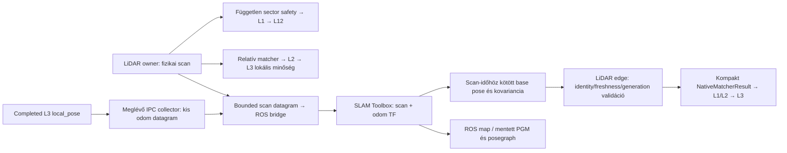

# SLAM Toolbox az R2B4 V3-ban

## Architekturális döntés és megvalósítás

A globális LiDAR-lokalizáció választható szolgáltatója a SLAM Toolbox 2.8.5.
Az L3 továbbra is birtokolja az elfogadott globális pózt és a map→odom
transzformációt. A lokális encoder/IMU odometria és a relatív LiDAR-regisztráció
megmarad. A SLAM occupancy grid nem kerül az L4 operational costmap helyére.
Az L5–L12 és a CommandGateway/motor/safety út nem változik.

Az illesztés a meglévő processzes LiDAR adapterben történik, új scheduler,
event bus vagy layer nélkül. Az authority-szabályok nem változnak, ezért a
`STRUKTURALIS_RETEGEK_V3.md` és `ASZINKRON_RUNTIME_CONTRACT_V3.md` változatlan.



A releváns source-határok:

| Felelősség | Megvalósítás |
| --- | --- |
| Aktív backend és azonos kovariancia-alapok feloldása | `v3/config.py`, `conf/vezerles.json` |
| Fizikai scan közvetlen exportja, kompakt completion lezárása | `v3/adapters/process_lidar_port.py` |
| Konkrét bounded scan/odom/pose protokoll, validáció | `v3/adapters/slam_toolbox_transport.py` |
| ROS scan/TF, lifecycle, korrelált pózválasz | `v3/slam_toolbox_bridge.py` |
| Meglévő typed source és replayelhető lineage | `v3/adapters/latest_lidar.py`, `live_lidar.py` |
| Felügyelt host-életciklus és térképmentés | `tools/slam_toolbox.py`, `r slam` |

## Idő, frame és érvényesség

* A fizikai scan mérésideje változatlanul az acquisition-intervallum pontos
  közepe. Start/end, source sequence és session identity megmarad.
* A ROS epoch egyszeri, rögzített offsettel képződik a monoton időből. A póz
  visszakorrelálása egész nanomásodperces scan stamp alapján történik; receipt
  vagy callback idő nem helyettesíti a mérésidőt.
* ROS odom kizárólag `estimate.local_pose`, `R2B4_ODOM_LOCAL` frame-ben.
  A globálisan korrigált `estimate.x_m/y_m/yaw_rad` nem jut vissza odomként.
* Scan-időhöz csak azonos session/generation, minősített lokális minták között,
  legfeljebb 100 ms-os bracketből interpolálunk. Extrapoláció nincs.
* A RPLIDAR clockwise szögéből CCW polar bin készül. Egy bin legközelebbi
  érvényes visszaverődése marad meg. Az üres bin nulla, érvénytelen mérés;
  nem kitalált maximális hatótávú szabad sugár.
* A kalibrált LiDAR X/Y offset a producer konfigurációjából kerül a base→laser
  TF-be. Karto `GetCorrectedPose()` már a robotbázis póza.
* A rebinelt scan egyetlen midpoint-pózt használ, `time_increment=0` mellett.
  Ez nem per-ray deskew; nagy sebességű forgás alatti torzítás nincs bizonyítva.
* A teljes síkbeli 3×3 kovariancia véges, pozitív diagonálisú, szimmetrikus és
  PSD kell legyen. A korrelációkat konzervatív diagonális felső korlát őrzi.
  A receiver 0,25-nél nagyobb varianciát nem fogad el. L3 ugyanabból a feloldott
  variancia-alapból számol, és legalább a kapott bizonytalanságot használja.
* Az első, nagy bizonytalanságú SLAM bootstrap-póz nem lesz automatikusan
  control-grade fix. Az L3 meglévő innovation/minőség kapui továbbra is élnek.

A visszaút ellenőrzi a sikeresen exportált scan identityt, eredeti midpointot,
frissességet, lokális generációt, bridge-generációt és sorrendet. Más runtime,
régi/duplikált scan vagy régi worker eredménye nem fogadható el. Odom-generation
váltás azonnal visszavonja a korábbi completiont. Egy már elfogadott bridge
újraindulása ugyanazon robot-runtime alatt explicit elutasítás: új térképi origó
nem keverhető a korábbival. Ilyenkor a robot-runtime és a SLAM session együtt
indítandó újra biztonságos, inaktív határon.

A SLAM kiesése nem fizikai LiDAR-hiba. Az érvényes közvetlen safety scan és a
lokális perception működhet tovább; hiányzó/stale globális fix nem ad új
globális navigation-authorityt. Automatikus natív globális fallback nincs.

## Terhelési és függőségi határ

A control interpreter csak kis skalár snapshotot sorba helyez a már meglévő
collectornek. A scan bejárása, binning, ROS, numpy, térkép, posegraph, DDS és
fájl-I/O a control interpreteren kívül marad.

| Adat | Maximum |
| --- | --- |
| Scan | 720 bin, 2948 byte, 5 Hz |
| Lokális odom | 68 byte, a meglévő 50 Hz-es tickből |
| Pózkorrekció | 96 byte, legfeljebb 5 Hz |
| Nyers transport-payload összesen | körülbelül 18,6 kB/s |
| Odom history / scan association | 128 / 32 elem |

A Unix datagram socket nem blokkoló; nincs felhalmozódó megbízható queue.
Full/dead/absent consumer esetén a publikáció eldobható, a számlálók láthatók.
Consumer nélkül nincs scan-encode vagy socket-allokáció, a demand-probe 1 Hz.
SLAM backendnél a korábbi natív globális matcher nem fut párhuzamosan.

A host supervisor a ROS processzeket a konfigurált control CPU-n kívül,
alacsonyabb prioritással futtatja. A ROS környezet külön Python 3.12 prefix,
a robot Python 3.11 környezete változatlan. A RoboStack Linux aarch64 lock
432 konkrét csomagot rögzít; a telepített prefix ezen a gépen körülbelül 2,3 GB.
A build és a letöltés csak leállított robot mellett célszerű: a csomagok
kibontása ideiglenesen jelentős SD-kártya I/O-t okoz.

A térképezés véges session: alapból legfeljebb 30000 publikált scan, 7200 s és
1000000 occupancy cell. A budget kimerülése explicit capability-failure;
nem automatikus restart vagy időbélyeg-megújítás. Ez beltéri, felügyelt
térképezési session, nem igazolt korlátlan, többnapos SLAM-üzem.

## Használat és telepítés

A pontos környezet: `deploy/slam_toolbox-linux-aarch64.lock`; az emberileg
olvasható közvetlen függőségek: `deploy/slam_toolbox-environment.yml`.
Izolált micromamba/pixi telepítési cél:
`runtime/deps/slam-toolbox`. A binárisok és térképek nem Git source-artifactok.

Az aktív globális backend helye:
`conf/vezerles.json` → `lidar_runtime.global_backend`, értéke `native` vagy
`slam_toolbox`. Konfigurációt kizárólag leállított robotnál cserélj.

```bash
./r slam start
./r slam status
./r runtime start c full c 50
# Csak a megszokott canonical robotparancsokkal végzett, engedélyezett mozgás.
./r slam save --output szoba_1
./r sd
./r slam stop
```

`r slam start` kizárólag a SLAM edge-et indítja; nem indít robotmozgást.
Az `ACTIVE` ROS lifecycle önmagában nem bizonyít friss lokalizációt: a robot
readiness és az elfogadott L3 fix a canonical runtime truth.
Mentés: PGM/YAML occupancy, `.posegraph`/`.data`, valamint lineage JSON a
`runtime/slam_toolbox/maps/` alatt. Mentett térképet a rendszer nem tölt vissza
automatikusan más boot-frame-be.

Capture után a canonical Replayer és az explicit MCAP Evidence Compiler
használandó; replay közben ROS/SLAM worker nem indul. Az adott tick lezárt
`TickInputs` és completion-láthatóság a replay inputja.

## Validáció és bizonyítási határ

A végső konkrét futási eredményeket a mellette lévő
`SLAM_TOOLBOX_VALIDACIO_20261106.md` rögzíti. Külön kezelendő a szoftvergate,
a valódi ROS-csomag szintetikus próbája, az élő szenzoradat, a fizikai mozgás,
az exact replay és a hosszú távú/loop-closure minőség. Egyik sem helyettesíti
a másikat.

A bemeneti és plugin-viselkedést az [upstream SLAM Toolbox Jazzy source](https://github.com/SteveMacenski/slam_toolbox/tree/jazzy)
alapján ellenőriztük; a ROS környezet telepítési alapja a
[RoboStack útmutató](https://robostack.github.io/GettingStarted.html).
